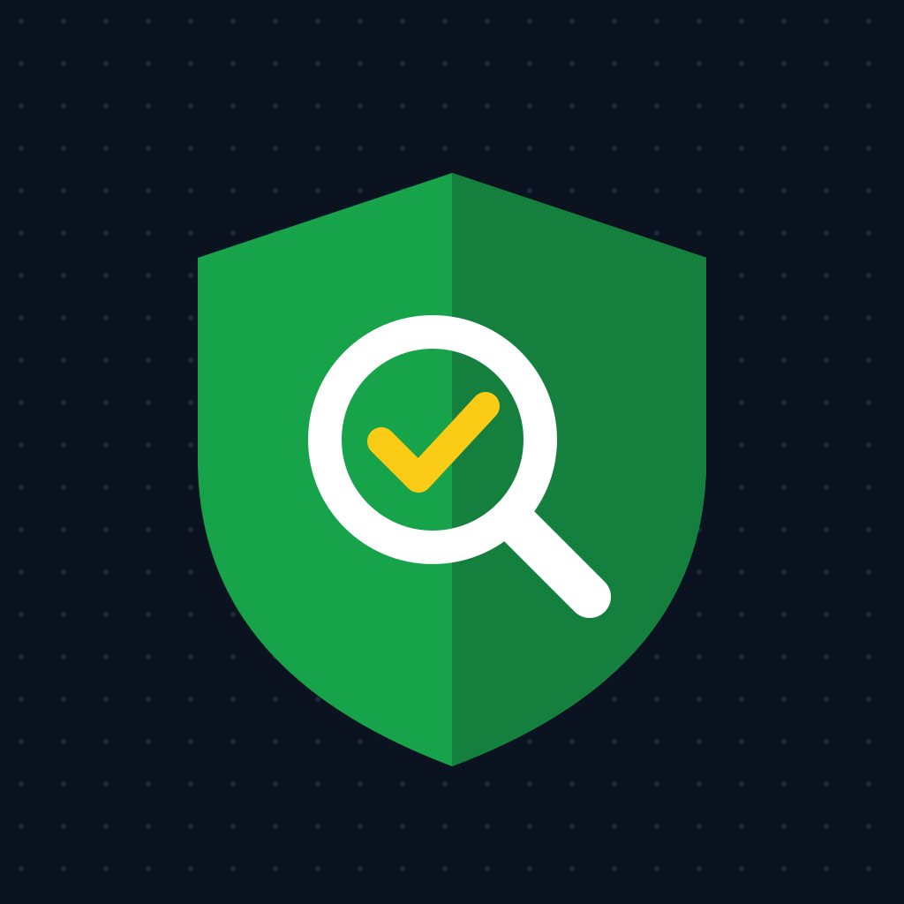

### Hi, I'm binyamin78 👋

I build **offline-first QA tools**: apps that respect privacy by design, come with automated tests, and are documented well enough for testers, developers and managers to pick up.

- 🔍 **Quality** · every project ships with a test suite and CI
- 🔒 **Privacy** · no tracking, no accounts, no data leaves the device unless you share it
- 🛡️ **Security** · protected main branch, secret scanning, Dependabot and private vulnerability reporting

---

#### 📋 Featured project

**[QA Daily Offline](https://github.com/binyamin78/qa-daily-offline)**: a fully offline Android app for daily QA reports. Today dashboard, change since yesterday, pace forecast, test execution, bug balance, weekly summaries and Hebrew / English reports. No internet permission.

[Download the APK](https://github.com/binyamin78/qa-daily-offline/releases/latest) · [Roadmap](https://github.com/users/binyamin78/projects/1) · [Architecture](https://github.com/binyamin78/qa-daily-offline/blob/main/docs/ARCHITECTURE.md)

---

#### 🧰 Tools I use

---

#### 💬 Get in touch

Found a bug or have an idea? Open an issue in the relevant repository. Security problems: please use **Security → Report a vulnerability** in that repository instead of a public issue.

All projects here are personal open-source work, provided "as is" under their licenses, without warranty. They are not affiliated with any employer or with the third-party products they mention.
